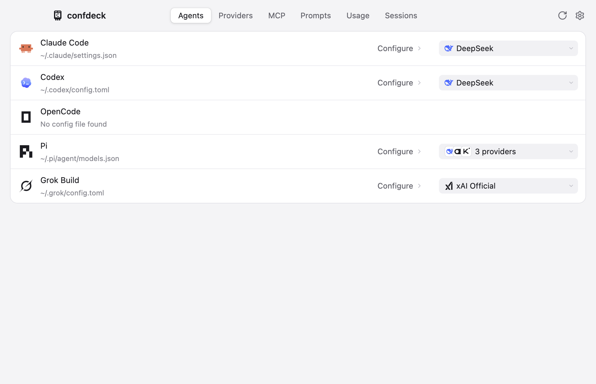
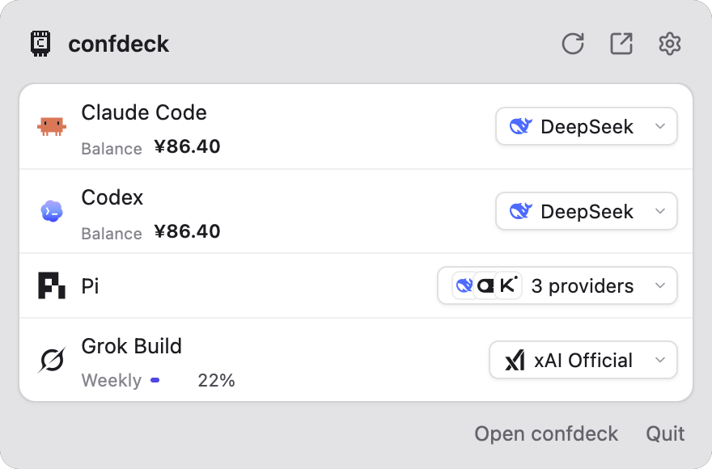
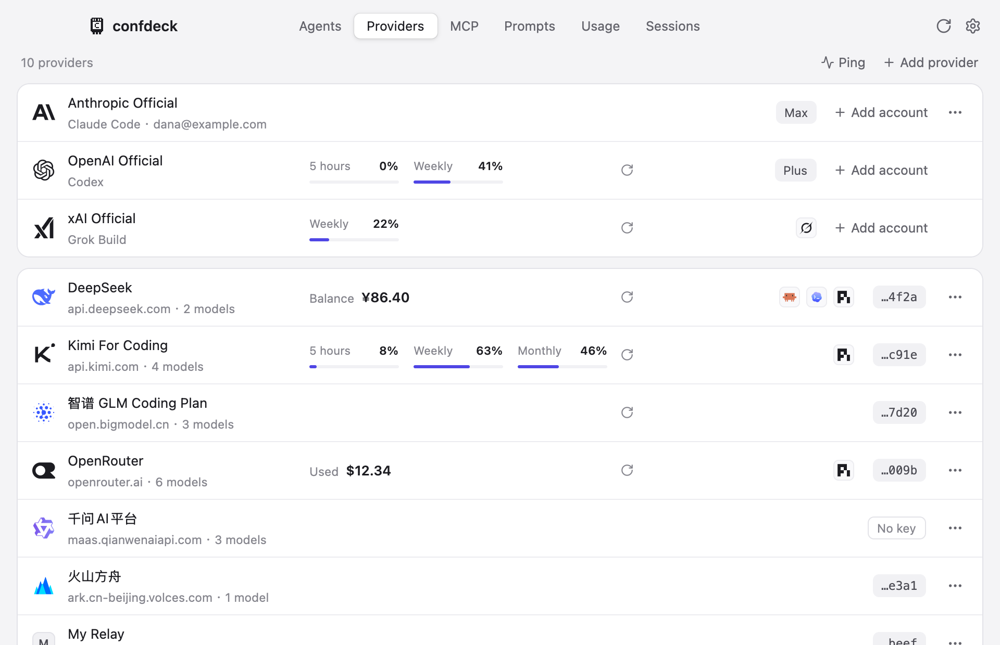
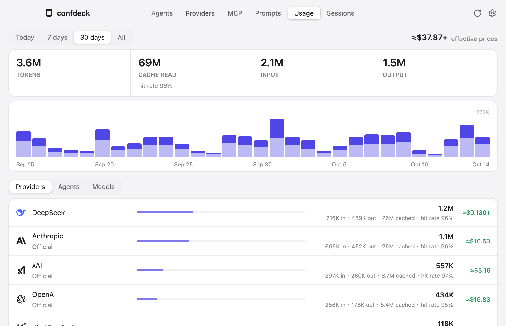
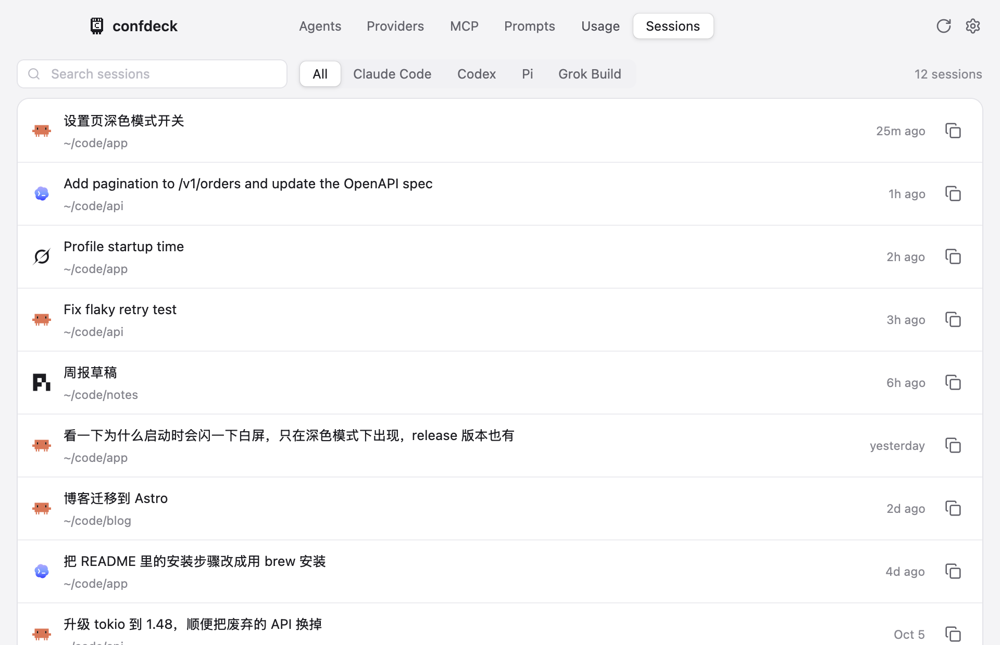

# confdeck

English | [简体中文](README.zh-CN.md)

A GPUI app for coding agents: switch model providers, manage their config files, check usage. It aims to stay small and focused.

Supported agents: Claude Code, Codex, Grok Build, OpenCode, Pi.



## Features

- **Switch providers.** Pick a provider for each agent from the main window or the menu bar panel. Agents that take one provider at a time (Claude Code, Codex, Grok Build) get a single choice; agents that can use several at once (Pi, OpenCode) get checkboxes.
- **Edits only the keys it owns.** Writes change only the keys confdeck manages. Everything else in the file, including comments and formatting in JSON5, JSONC and TOML, stays as it was. Every write makes a backup first and replaces the file atomically.
- **Built-in providers.** 42 presets with endpoints, model lists and recommended settings for each agent, plus custom providers.
- **Provider tools.** Test endpoints, fetch model lists, fill in context length and pricing from models.dev, import and export providers (with or without keys). An outbound proxy setting applies to all of these requests.
- **Usage.** Reads each agent's session logs to count tokens and estimate cost per provider. Shows account balances and subscription quota windows.
- **Sessions.** Lists sessions across agents, shows the conversation, and copies the command to resume one.
- **Official accounts.** Save several logged-in accounts for Claude Code, Codex and Grok Build and switch between them. Claude Code tokens are kept in the macOS Keychain.

## Preview

### Menu bar panel



### Providers



### Usage



### Sessions



## Build

Requires macOS and a recent stable Rust toolchain (edition 2024).

```bash
cargo run -p confdeck-app
```

Release build (output in `target/dist/`):

```bash
cargo build --profile dist -p confdeck-app
```

## Acknowledgements

The key-level patching, the write engine and the per-agent key lists are ported from [farion1231/cc-switch](https://github.com/farion1231/cc-switch) (MIT).

The UI is modeled on [yetone/magpie](https://github.com/yetone/magpie).

Built with [GPUI](https://www.gpui.rs) and gpui-kit.

## License

[MIT](LICENSE)
