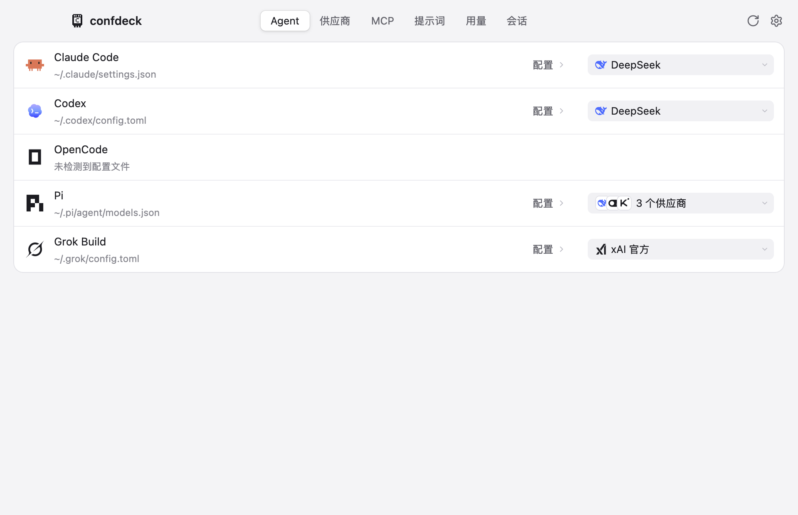
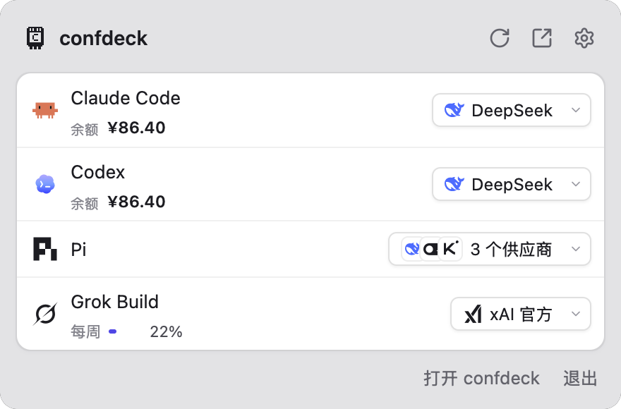
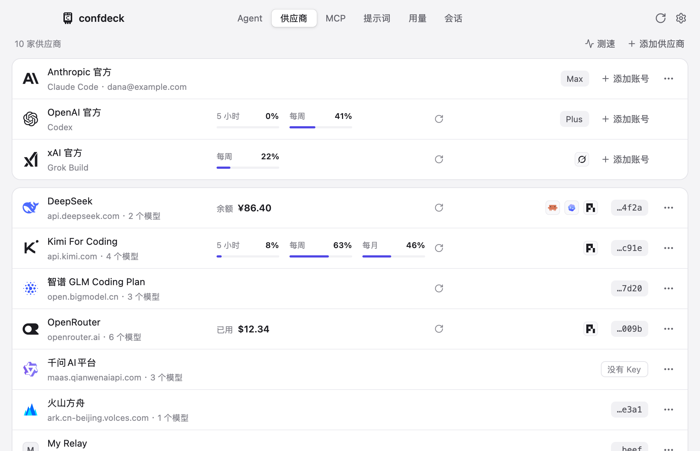
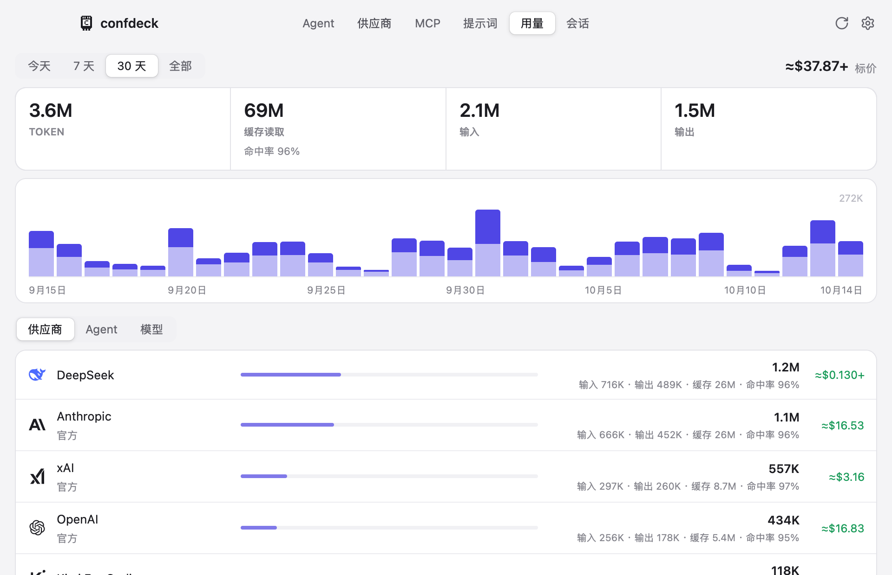
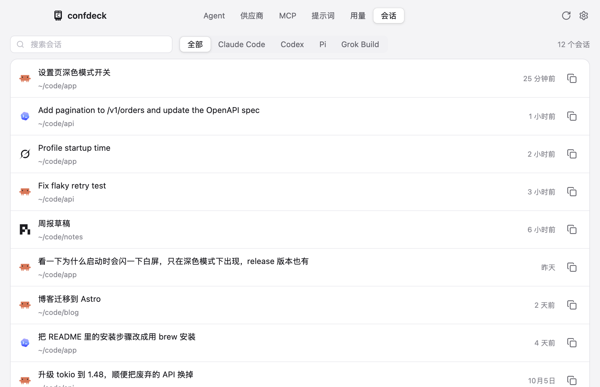

# confdeck

[English](README.md) | 简体中文

为 agent 切换模型供应商、配置管理以及用量查询等的基于 GPUI 的应用。致力于轻量、专一。

支持的 agent：Claude Code、Codex、Grok Build、OpenCode、Pi。



## 功能

- **切换供应商**：在主窗口或菜单栏面板里给每个 agent 选供应商。一次只用一家的 agent（Claude Code、Codex、Grok Build）是单选；能同时用几家的（Pi、OpenCode）是多选。
- **只改自己管的键**：写入时只改 confdeck 管的那几个键，文件里其余内容原样保留，JSON5、JSONC、TOML 里的注释和排版也不动。每次写入先备份，再原子替换文件。
- **内置供应商**：42 家预设，带接口地址、模型列表和给各 agent 的推荐值；也可以自己加。
- **供应商工具**：测接口连通、拉模型列表、按 models.dev 补上下文长度和价格、导入导出供应商（可以不带 Key）。这些请求都走设置里的出站代理。
- **用量**：读各 agent 的会话记录，按供应商统计 Token、估算花费；显示账户余额和订阅额度。
- **会话**：列出各 agent 的会话，查看对话内容，复制恢复会话的命令。
- **官方账号**：Claude Code、Codex、Grok Build 可以存多个登录的账号来回切换。Claude Code 的令牌存在 macOS 钥匙串里。

## 预览

### 菜单栏面板



### 供应商



### 用量



### 会话



## 构建

需要 macOS 和较新的 Rust stable 工具链（edition 2024）。

```bash
cargo run -p confdeck-app
```

发布构建（产物在 `target/dist/`）：

```bash
cargo build --profile dist -p confdeck-app
```

## 致谢

按键补丁、写入引擎和各 agent 的关键字段清单移植自 [farion1231/cc-switch](https://github.com/farion1231/cc-switch)（MIT）。

界面仿照了 [yetone/magpie](https://github.com/yetone/magpie)。

基于 [GPUI](https://www.gpui.rs) 和 gpui-kit。

## 许可

[MIT](LICENSE)
